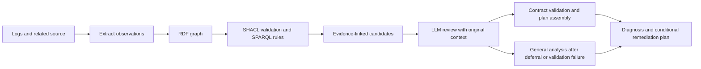

# Method and experimental scope

For supported error patterns, the system extracts observations from logs, source code, Dockerfiles, ignore settings, and archive inventories. It constructs an RDF graph using a predefined schema, checks structural constraints with SHACL, and applies explicit SPARQL rules to generate file-read and COPY candidates. The LLM reviews candidates alongside the original context. When a candidate is accepted, the server assembles evidence and a conditional remediation plan. Deferral or certain contract errors trigger general source analysis.

Passing SHACL does not prove the actual cause. The SPARQL rules are not described as general OWL reasoning. The experiments do not evaluate general-purpose graph construction or generalization to unsupported languages or error patterns.

## Latest comparison conditions

| Comparison | Condition | Role |
| --- | --- | --- |
| E1 | R_auto | Automatically accept graph candidates |
| E1 | R_llm | Have the LLM review the same candidates with their context |
| E2 | B_eq | Baseline with the same output contract and no candidate fields |
| E2 | G_eq | Add candidate fields to the matched baseline |

The programs are shipping-cli, template-http, and settlement-batch. Each program has P_supported, P_unknown, N_external_supply, and N_snapshot_conflict contexts. R_auto runs once per context; the other conditions have 3 repetitions, giving 120 rows. E2 has 36 matched pairs with identical common inputs, prompts, schemas, and generation settings.

Prepared input packets were used at model-call time. Recorded API timings therefore do not measure end-to-end latency from graph construction through Docker recovery. The three programs' base incidents, authored contexts, and repeated observations must be distinguished as sampling units.

Implementation files: `knowledge/ontology.ttl`, `knowledge/*shapes.ttl`, `knowledge/rules/*.rq`, `graph_compact.py`, `packaging_plan.py`, `tools/review_controls_common_v4.py`, and `tools/review_controls_contract_v2.py`.
