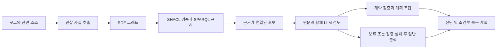

# 방법론과 실험의 범위

지원하는 오류 패턴의 로그·소스·Dockerfile·ignore 설정·아카이브 목록에서 관찰 사실을 추출합니다. 미리 정한 스키마에 따라 RDF 그래프를 만들고 SHACL로 구조 제약을 검사한 다음, 명시적인 SPARQL 규칙으로 파일 읽기 및 COPY 관련 후보를 만듭니다. LLM은 후보와 원문 문맥을 검토하고, 채택 시 서버가 근거와 조건부 수정 계획을 조립합니다. 보류나 일부 계약 오류에서는 일반 소스 분석으로 전환합니다.

SHACL 통과는 실제 원인 증명이 아니며, SPARQL 규칙을 일반 OWL 추론으로 표현하지 않습니다. 지원하지 않는 언어·오류 패턴에 대한 범용 그래프 구축과 일반화 성능을 평가한 실험이 아닙니다.

## 최신 비교 조건

| 비교 | 조건 | 역할 |
| --- | --- | --- |
| E1 | R_auto | 그래프 후보를 자동 채택 |
| E1 | R_llm | 같은 후보를 LLM이 원문과 함께 검토 |
| E2 | B_eq | 동일 출력 계약의 기준선, 후보 필드 없음 |
| E2 | G_eq | 대응 기준선에 후보 필드를 추가 |

프로그램은 shipping-cli, template-http, settlement-batch입니다. 각 프로그램에 P_supported, P_unknown, N_external_supply, N_snapshot_conflict 문맥을 구성했습니다. R_auto는 문맥당 1행, 나머지 조건은 3회 반복하여 120행입니다. E2에서 공통 입력·프롬프트·스키마·생성 설정이 같은 36개 대응 쌍을 확인했습니다.

모델 호출 직전에는 준비한 입력 패킷을 사용했습니다. 따라서 기록된 API 시간은 그래프 구축부터 Docker 복구까지의 전체 시스템 지연이 아닙니다. 세 프로그램의 기본 장애, 저자 통제 문맥, 반복 관측을 서로 다른 표본 단위로 기술해야 합니다.

구현 파일: `knowledge/ontology.ttl`, `knowledge/*shapes.ttl`, `knowledge/rules/*.rq`, `graph_compact.py`, `packaging_plan.py`, `tools/review_controls_common_v4.py`, `tools/review_controls_contract_v2.py`.
